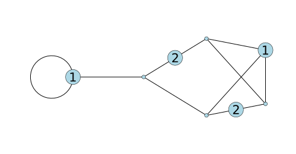

# TropicalLinearSystems.jl

A Julia package for exploring linear systems of divisors on tropical curves
(metric graphs with unit edge lengths): chip-firing, reduced divisors, linear
systems, extremals, realizability of canonical divisors, and exact rational
functions with tropical (max-plus) operations.



*An extremal of the canonical linear system |K| on a trivalent genus 4 curve,
drawn with `plotcurve`. Two of its chips lie in the interior of edges.*

This repository also contains the Pluto notebook with my experiments, which
uses the package.

## Installation

You need [Julia](https://julialang.org/downloads/) 1.9 or newer
(the notebook environment needs 1.11 or newer).
The package is not registered, so add it from GitHub:

```julia
] add https://github.com/MattDupraz/Graph-Linear-Systems
```

or, from a clone of the repository, `] dev .`.

## Usage

```julia
using TropicalLinearSystems

# A tropical curve is a graph whose edges all have length 1
G = TropicalCurve(4)
add_edges!(G, (1, 2), (1, 3), (1, 4), (2, 3), (2, 4), (3, 4))

K = canonical(G)

# Divisors of |K| supported on the vertices, with level maps f s.t. D = K + div(f)
divisors, level_maps = get_linear_system(G, K)

# Work on a finer model of the same metric graph
Gsub = subdivide_uniform(G, 2)
divisors_sub, fns_sub = get_linear_system(Gsub, canonical(Gsub))
is_realizable(Gsub, fns_sub[1])

# Extremals of |K|, as exact rational divisors and rational functions
extremals, extremal_fns = get_extremals(G, K)
f = as_rational_function(Gsub, fns_sub[1])
is_in_span(f, extremal_fns)

# Tropical operations on rational functions: ∔ (max) and ⨰ (+)
g = extremal_fns[1] ∔ extremal_fns[2] ⨰ (1//2)

# All trivalent graphs of genus 3 and 4
genus3_graphs(), genus4_graphs()
```

### Plotting

The package provides a Plots.jl recipe, so plotting works once Plots is loaded:

```julia
using Plots
plotcurve(G)                                   # vertices labelled by index
plotcurve(Gsub, divisors_sub[1])               # a divisor on a subdivision
plotcurve(G, extremals[1]; nodecolor=:red)     # chips in the interior of edges
```

The layout only depends on the underlying curve, so a curve and all its
subdivisions are drawn the same way. Parallel edges are drawn as arcs and loops as
circles. Use `seed` to try a different layout.

## The notebook

The notebook is at `notebooks/graphs.jl`. A static snapshot can be viewed at
<https://mattdupraz.github.io/Graph-Linear-Systems/>.

To run it locally, install Pluto (`] add Pluto`), then run `using Pluto; Pluto.run()`
and open `notebooks/graphs.jl`. The notebook activates the environment in the
`notebooks/` folder, which loads the package from this repository, so changes
to `src/` are picked up when the notebook is restarted.

## Tests

```julia
] test TropicalLinearSystems
```
